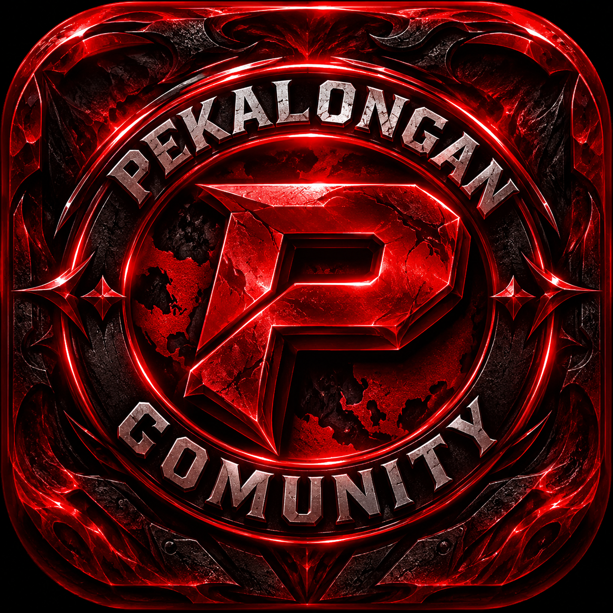

▓ PEKALONGAN-404 ▓

HANTU BATIK CITY

"WELCOME TO THE DARK SIDE OF INTELLIGENCE"

 

 

  

" REPOSITORY " (https://github.com/jambudio336-hue/Rotiku) ・ " ISSUES " (https://github.com/jambudio336-hue/Rotiku/issues) ・ " CHANGELOG " (CHANGELOG.md)

---

"01 // WHAT IS PEKALONGAN-404?"

PEKALONGAN-404 — HANTU BATIK CITY is a dark-themed AI intelligence interface and browser-based technical toolkit designed for users who want a flexible environment for AI interaction, technical exploration, OSINT utilities, and security research.

This project combines artificial intelligence, browser technologies, voice interaction, and technical utilities inside one cyberpunk-inspired application.

«"NOT JUST AN INTERFACE. AN ENTIRE DIGITAL EXPERIENCE."»

◈ CORE PHILOSOPHY

- Freedom of interaction.
- Flexible AI model selection.
- Minimal application-level restrictions on conversational workflows.
- Technical exploration.
- User-controlled AI configuration.
- Dark, immersive, and responsive experience.

"02 // NO-FILTER AI EXPERIENCE"

PEKALONGAN-404 introduces a NO-FILTER AI EXPERIENCE philosophy.

The goal is to provide a conversational environment where users can explore ideas, ask difficult questions, discuss controversial topics, experiment with technical concepts, and interact with AI without unnecessary application-level restrictions.

What this means:

- Flexible conversational interaction.
- Configurable AI models through OpenRouter.
- Freedom to explore different subjects.
- Technical and educational discussions.
- Adjustable AI behavior and parameters.
- A user-focused conversational interface.

Transparency notice: PEKALONGAN-404 does not guarantee unrestricted AI output. Actual responses and restrictions depend on the selected AI model, API provider, model configuration, applicable policies, and technical limitations. The project does not bypass third-party safety systems.

"03 // SYSTEM FEATURES"

[ AI INTELLIGENCE ]

- AI conversational interface.
- OpenRouter API integration.
- Streaming responses.
- Dynamic model selection.
- Configurable AI parameters.
- Conversation history.
- File and image attachments.
- Import and export functionality.

[ VOICE SYSTEM ]

- Browser speech synthesis.
- Voice selection.
- Adjustable speech settings.
- Interactive voice interface.

[ CYBER TOOLKIT ]

- DNS lookup.
- WHOIS lookup.
- HTTP header inspection.
- IP geolocation.
- CIDR calculator.
- JWT decoder.
- Hash generator.
- Hash identification.
- Password generator.
- UUID generator.
- Encoding and decoding utilities.
- Wordlist generator.
- Common port reference.

[ OSINT INTELLIGENCE ]

- Search dork generator.
- Subdomain reconnaissance interface.
- Web intelligence utilities.
- External research integrations.

[ VISUAL ENGINE ]

- Matrix-style animated background.
- Dark cyberpunk interface.
- Neon red visual identity.
- Glitch-inspired visual direction.
- Animated interface elements.
- Video background.
- Responsive mobile interface.

"04 // TECHNOLOGY STACK"

Technology| Implementation
HTML5| Application structure
CSS3| Styling and animation
JavaScript| Application logic
OpenRouter| AI integration
Web Speech API| Voice functionality
Local Storage| Browser persistence
External APIs| Selected utilities

"05 // INSTALLATION"

Clone the repository

git clone https://github.com/jambudio336-hue/Rotiku.git

Enter the directory

cd Rotiku

Start local server

python3 -m http.server 8080

Access application

http://localhost:8080

You can also open "index.html" directly in a compatible browser.

"06 // AI CONFIGURATION"

PEKALONGAN-404 uses OpenRouter for AI connectivity.

1. Visit https://openrouter.ai/
2. Create an account.
3. Generate an API key.
4. Open the application.
5. Configure the API key.
6. Select an available AI model.
7. Start interacting.

Model availability, pricing, context limits, and provider restrictions may vary.

"07 // SECURITY & PRIVACY"

Security matters.

Current implementation uses browser Local Storage for selected application settings and user data.

Important considerations:

- Base64 is encoding, not encryption.
- API credentials stored in browser storage can be exposed to someone with access to the browser profile.
- External API requests may transmit user-provided information.
- Third-party proxies and services may have their own privacy policies.
- Do not enter sensitive production credentials into an untrusted environment.

Future improvements should prioritize secure credential management and stronger data protection.

"08 // PROJECT STRUCTURE"

Rotiku/
│
├── .github/
│   └── workflows/
│
├── android/
│
├── anime.mp4
├── iccon.png
├── index.html
│
├── README.md
├── CHANGELOG.md
├── LICENSE
└── SECURITY.md

"09 // ROADMAP"

- [ ] Advanced AI configuration.
- [ ] Improved credential protection.
- [ ] Modular JavaScript architecture.
- [ ] Enhanced mobile experience.
- [ ] Improved error handling.
- [ ] Automated testing.
- [ ] Android build documentation.
- [ ] Expanded OSINT utilities.
- [ ] Improved documentation and developer experience.

"10 // CONTRIBUTION"

Want to improve the system?

Contributions are welcome.

git fork
git checkout -b feature/new-feature
git add .
git commit -m "feat: add new feature"
git push origin feature/new-feature

Submit a Pull Request with a clear description of your changes.

"11 // DEVELOPER"

"MR.KIPLAY"

CREATOR & DEVELOPER

PEKALONGAN-404 — HANTU BATIK CITY

""GitHub" (https://img.shields.io/badge/GITHUB-000000?style=for-the-badge&logo=github&logoColor=FF003C)" (https://github.com/jambudio336-hue)

"12 // LICENSE"

This project is licensed under the MIT License.

See "LICENSE" (LICENSE) for complete details.

---

PEKALONGAN-404 © 2026

"ENGINEERED IN THE DARK. BUILT FOR EXPLORATION."

